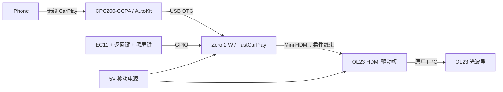

# Goggle Lite · OL23 CarPlay HUD V1

分体式单目透明 CarPlay 风镜原型。iPhone 运行导航和应用，胸前 Zero 2 W 负责视频解码、HDMI 和 GPIO 交互，风镜只负责显示。

已拥有 Zero 2 W、Pico 1 和 3D 打印机。本版不使用 Pico，不定制 PCB；面包板验证后飞线，滚轮、按键帽、支架和外壳自行打印。先使用移动电源，电池集成后置。

## 从这里开始

1. [采购清单](hardware/BOM.md)：首批、第二批、预算及购买前检查。
2. [实施待办](docs/plan.md)：M0–M6 和验收关卡。
3. [接线规划](hardware/wiring.md)：GPIO、USB、HDMI 和供电。
4. [软件准备](host/README.md)：FastCarPlay 来源、配置及适配边界。
5. [淘宝检索](research/taobao.md)：商品候选与验证记录。
6. [测试计划](tests/test_plan.md)、[结构规划](mechanical/README.md)、[需求基线](docs/requirements.md)。

目前完成的是项目规划与采购研究，尚未部署到树莓派、采购或完成实物测试。主要关卡为 AutoKit 具体硬件版本兼容性、OL23 HDMI 时序和户外可读性。

来源：[原分享](https://chatgpt.com/share/6afac55f-4244-83e8-bf40-7b98fdae869a)，正文由用户于 2026-11-16 粘贴。原图未包含在粘贴内容中；光学及驱动板参数均暂按对话转述保存，待原规格书与商家复核。
