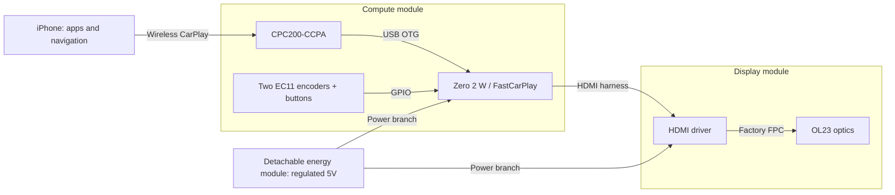

# Goggle Lite

**A validation prototype for separating display, compute, and energy modules.**

[English](#purpose) | [中文](#中文说明)

## Purpose

Goggle Lite investigates whether a lightweight head-worn display can work with physically separate computation and power. The V1 demonstration uses CarPlay navigation; the project validates the modular architecture rather than building a finished CarPlay product.

**Sustained glasses wear drives the architecture:** the head-worn module must be as light, small, and simple as practical. Retain only essential display functions on the frame; move compute, energy and controls off-head. The ≤30g added-mass target is a provisional ceiling, not proof of comfort. See the [wearability rationale and verification method](docs/wearability.md).

Three module boundaries are explicit:

| Module | V1 implementation | Boundary to validate |
|---|---|---|
| Display | OL23 optics + HDMI driver on goggles | HDMI video and separate regulated power; no head-mounted battery |
| Compute | Existing Raspberry Pi Zero 2 W + CPC200-CCPA + GPIO controls | Receive/decode the demonstration workload and output HDMI |
| Energy | USB 5V from an external power bank; no custom battery or charging board | Detachable supply to compute and display, with measured power and voltage drop |

The compute and energy modules may share a chest mounting location, but remain separable assemblies with documented connectors. They are not required to share a single sealed enclosure. Modularity does not imply electrical isolation or hot-swap support.

## V1 scope and status

Wireless CarPlay and two-axis EC11 control work on the Zero 2 W with the standard HDMI monitor. Short prototype reversal and axis-switching checks passed. The next step is identifying the optical driver's HDMI input and power requirements. [2026-11-27 progress and next steps](docs/progress.md)

Use existing Zero 2 W and a 3D printer; Pico is not used. Validate controls on a breadboard, then solder point-to-point wiring. Print the wheel, button caps, mounts and enclosures. No custom PCB, battery pack or charging board is planned for V1. USB power comes from an external power bank.

**Status:** Bookworm boot and local FastCarPlay build passed. The user confirmed wireless pairing and a normal CarPlay picture. One software restart reconnected in 22.56 s, exceeding the 15 s target on that timing basis. Purchases/arrival are user-reported, with delivered versions still to be checked. Optical specifications supplied in the original discussion have not been checked against the missing original images. Dimensions, weight, runtime and budgets are targets or estimates.

The first gates are the purchased AutoKit adapter's FastCarPlay compatibility, OL23 input timing/readability, and stable detachable power distribution. Keep an ordinary monitor available to test the compute path independently of the optics.

## Documentation and purchasing

All maintained documents present English first and Chinese second.

- [Requirements and module boundaries](docs/requirements.md)
- [Milestones and TODOs](docs/plan.md)
- [Bill of materials and budget](hardware/BOM.md)
- [Purchasing link list and verification status](hardware/purchasing.md)
- [Wiring and power interfaces](hardware/wiring.md)
- [FastCarPlay software preparation](host/README.md)
- [Mechanical planning](mechanical/README.md)
- [Validation plan](tests/test_plan.md) and [result template](tests/test_results/README.md)
- [Sourcing index](research/taobao.md), [core modules](research/core-products.md), [accessories](research/accessories.md)

Upstream software: [niellun/FastCarPlay](https://github.com/niellun/FastCarPlay). The [bench setup](host/README.md) pins the upstream revision and applies a small USB compatibility patch under the upstream GPL v3 license.

## 中文说明

**本项目是验证显示、运算与能源模块分离的验证原型。**

V1 使用 CarPlay 导航作为演示负载，验证模块化架构。Zero 2 W 上的无线 CarPlay 和普通 HDMI 画面已验证，两只 EC11 已在台架上完成左右、上下、反转和双轴切换短测。下一步核对光波导驱动板的 HDMI 输入和供电。单次软件重启后手机自动连回用时 22.56 秒，按此次口径超过 15 秒目标。尺寸、重量、续航及预算仍为目标或估算。[2026-11-27 进展与下一步](docs/progress.md)

| 模块 | V1 实现 | 验证边界 |
|---|---|---|
| 显示 | 风镜上的 OL23 光学组件 + HDMI 驱动板 | HDMI 视频与独立稳压供电，头部无电池 |
| 运算 | 已有 Zero 2 W + CPC200-CCPA + GPIO 交互 | 接收并解码演示负载，输出 HDMI |
| 能源 | 外置充电宝经USB输出5V，不做自制电池或充电板 | 可拆离供电，测量功耗与线缆压降 |

**长期佩戴眼镜是架构的现实出发点：头部模块应尽量轻、尽量小、尽量简单。**头部只留显示必需功能，运算、能源和控件外移。新增重量≤30g只是暂定上限，不能证明长时间舒适，见[佩戴需求论证与验证方法](docs/wearability.md)。

运算和能源模块可以都固定在胸前，但应保持独立装配及明确连接器，不要求放在同一个封闭壳体内。模块化不等于电气隔离或支持热插拔。iPhone继续负责导航和应用层计算。

本版不使用Pico、不做定制PCB。编码器与两个按键直接接Zero GPIO，面包板验证后飞线；滚轮、按键帽、支架和外壳自行3D打印。V1通过USB由充电宝供电，不做自制电池或充电管理板。

优先验证具体AutoKit硬件版本的FastCarPlay兼容性、OL23输入时序与可读性、可拆离供电的稳定性。先用普通显示器独立验证运算链路，再接光学组件。

阅读顺序：[需求](docs/requirements.md) → [待办](docs/plan.md) → [采购清单](hardware/BOM.md) → [商品链接](hardware/purchasing.md) → [接线](hardware/wiring.md) → [软件](host/README.md) → [结构](mechanical/README.md) → [测试](tests/test_plan.md)。所有维护文档均英文在先、中文在后。
